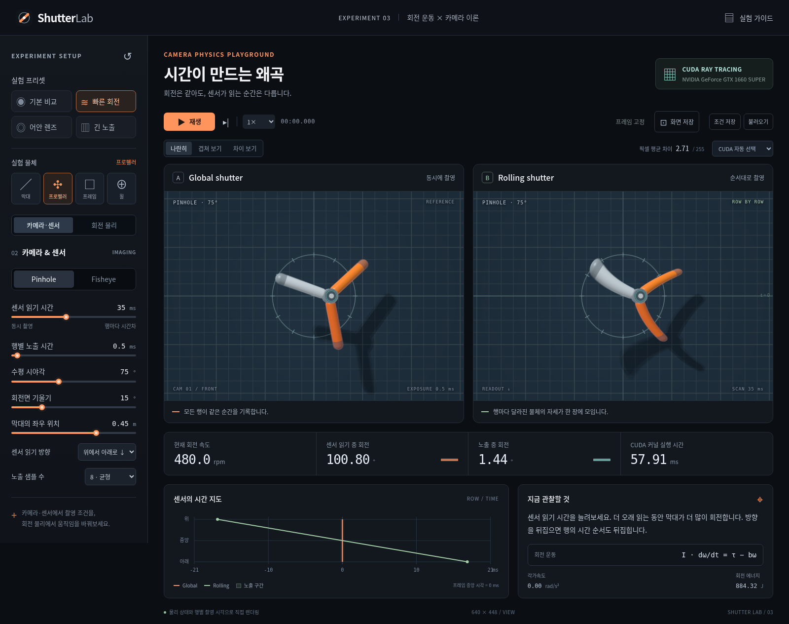

# ShutterLabStudy — Shutter Lab

An interactive camera physics lab for rolling shutter, motion blur, and pinhole/fisheye projection. Runs locally with WebGL2; an optional native CUDA renderer uses NVIDIA GPUs.

회전하는 물체를 **Global shutter와 Rolling shutter**로 동시에 관찰하는 카메라 물리 실험실입니다. 막대·프로펠러·사각 프레임·바퀴를 선택하고, 회전 운동·센서 읽기 시간·노출·렌즈를 조절하며 결과를 비교합니다.



## 바로 실행

**Node.js 22 이상**과 **WebGL2를 지원하는 Chromium 계열 브라우저**가 필요합니다. 저장소를 내려받고 프로젝트 폴더에서 실행하세요.

```sh
git clone https://github.com/studyreadbook4ever/ShutterLabStudy.git
cd ShutterLabStudy
npm start
```

브라우저에서 **<http://127.0.0.1:4317>**을 엽니다. 앱 실행에는 npm 패키지 설치나 CUDA가 필요하지 않습니다. CUDA 렌더러가 없으면 브라우저 WebGL2가 영상을 생성합니다. 화면의 렌더러 표시로 현재 백엔드를 확인할 수 있습니다.

다른 포트는 `SHUTTER_PORT=4318 npm start`로 지정합니다. 서버는 로컬 인터페이스에 바인딩됩니다. 종료는 터미널에서 `Ctrl+C`를 누릅니다. 환경 확인은 `sh scripts/setup.sh`로 할 수 있습니다. 자세한 설치와 문제 해결은 [실행 가이드](docs/getting-started.md)에 있습니다.

## GUI에서 할 수 있는 실험

| 조작 | 관찰할 내용 |
| --- | --- |
| 막대·프로펠러·사각 프레임·바퀴 선택 | 직선·반복 형상·회전 대칭이 영상에 나타나는 차이 |
| 초기 회전 속도, 토크, 관성, 감쇠 조절 | 일정한 회전, 가속, 감속의 차이 |
| 읽기 시간과 방향 변경 | 센서 행마다 다른 시각을 기록하는 효과 |
| 노출 시간과 시간 샘플 수 변경 | 회전 궤적의 누적과 모션 블러 |
| Pinhole / equidistant Fisheye, 시야각·기울기·위치 변경 | 원근·렌즈 투영과 시간 왜곡의 상호작용 |
| 나란히·중첩·차이 화면 | 같은 상태에서 셔터 방식만 바꾼 결과 |
| PNG와 JSON 저장, JSON 불러오기 | 결과 공유와 순간 상태를 포함한 실험 재현 |

처음에는 **기본 실험 → 고속 회전 → 어안 렌즈 → 긴 노출** 프리셋 순서로 살펴보세요. 한 번에 변수 하나를 바꾸면 변화의 원인이 더 잘 보입니다. 구체적인 순서는 [실험 가이드](docs/experiments.md)에 정리했습니다.

`Space`는 재생/정지, `R`은 현재 프리셋 초기화, `→`는 1/60초 진행입니다. 입력 중에는 단축키가 입력을 방해하지 않습니다. 일시정지 상태에서 회전각을 지정해 특정 자세를 비교할 수 있습니다.

## 실제 CUDA로 실행

NVIDIA GPU와 호환 드라이버, CUDA Toolkit 12 이상의 `nvcc`, `make`가 필요합니다.

```sh
npm run build:cuda
native/shutter-renderer --info
native/shutter-renderer --self-test
npm start
```

이미 서버가 실행 중이었다면 빌드 후 재시작하세요. 상단에 **CUDA**와 실제 장치 이름이 표시되는지 확인합니다. GUI에서 WebGL2를 선택해 같은 조건을 브라우저 렌더러로 실험할 수도 있습니다. WebGL2는 CUDA 코드를 실행하지 않습니다.

기본 빌드는 `nvcc`와 `-arch=native`를 사용합니다. 컴파일러나 GPU 아키텍처를 지정하려면 다음처럼 재정의합니다. `sm_XX`는 GPU에 맞는 실제 compute capability로 바꿉니다.

```sh
NVCC=/path/to/nvcc CUDA_ARCH=sm_XX npm run build:cuda
```

[CUDA 빌드 및 프로토콜](native/README.md)과 [백엔드 구조](docs/architecture.md)를 참고하세요.

## 모델과 검증

운동 모델은 고정 회전축을 가진 강체의 `I·dω/dt = τ − bω`를 해석적으로 적분합니다. 두 영상은 같은 프레임 중앙 시각의 상태·장면·렌즈·노출을 공유하고, 행별 노출 기준 시각이 다릅니다. 카메라는 이상적인 Pinhole 또는 equidistant Fisheye이며 실제 렌즈의 보정 계수·센서 노이즈는 포함하지 않습니다.

물체를 선택하면 권장 관성값을 적용하고, 이후 관성을 자유롭게 조절할 수 있습니다. 이 값은 형상·질량으로 자동 계산한 물성이 아닙니다. 같은 운동을 여러 형상으로 비교하려면 선택 후 관성을 같은 값으로 맞추세요. 현재 제공되는 네 가지 분석적 형상을 대상으로 하며 임의의 메시 파일을 불러오는 기능은 없습니다.

WebGL2와 CUDA는 같은 운동 법칙과 셔터 시각을 사용합니다. 수치 정밀도와 공간 샘플링·조명 구현에 차이가 있어 두 백엔드의 픽셀이 정확히 같다는 보장은 없습니다. 각 백엔드 안에서는 읽기 시간을 **0 ms**로 설정하면 두 셔터가 같은 촬영 조건이 됩니다.

‘읽기 중 회전’과 ‘노출 중 회전’은 모델이 예측하는 **각도 변화**입니다. RGB MAE는 두 프레임의 RGB 절대 차이 평균으로 0–255 범위의 영상 차이 지표입니다. 두 수치는 서로 다른 개념입니다. CUDA 시간은 커널 실행 시간이며, 브라우저 렌더 시간은 렌더링 완료까지의 경과 시간입니다. 자세한 식과 단위는 [물리·카메라 모델](docs/physics.md)에 있습니다.

```sh
# 개발·브라우저 검증용 의존성 설치
npm ci
npm test
npm run check
npx playwright install chromium
npm run test:browser

# CUDA 서버가 실행 중인 환경에서
npm run test:api
```

GitHub Actions는 NVIDIA GPU가 없는 Ubuntu에서도 물리·설정 테스트와 Chromium의 WebGL2 화면을 검증합니다. CUDA 실행은 GPU가 있는 환경에서 별도로 검증합니다. 브라우저 테스트는 전용 서버를 자동 실행하고 종료하며 결과 이미지는 `artifacts/`에 생성됩니다.

## 프로젝트 안내

- [실행과 문제 해결](docs/getting-started.md)
- [실험과 재현 방법](docs/experiments.md)
- [물리·카메라 모델](docs/physics.md)
- [코드 구조와 백엔드](docs/architecture.md)
- [기여 방법](CONTRIBUTING.md)
- [The Unlicense](LICENSE)

Rolling shutter의 센서 동작은 [Basler 공식 설명](https://docs.baslerweb.com/electronic-shutter-types), 보정 가능한 fisheye 모델은 [OpenCV 공식 문서](https://docs.opencv.org/4.x/db/d58/group__calib3d__fisheye.html), CUDA 구현 개념은 [NVIDIA CUDA Programming Guide](https://docs.nvidia.com/cuda/cuda-programming-guide/index.html)를 참고할 수 있습니다.
