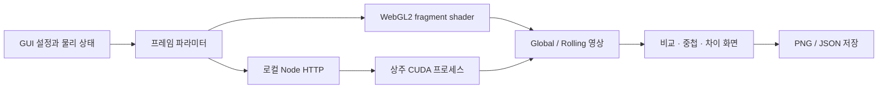

# 코드 구조와 백엔드

UI와 시뮬레이션 상태는 브라우저에서 실행됩니다. Node 서버는 정적 파일과 네이티브 CUDA 렌더 API를 제공합니다. Node 내장 모듈만 사용하므로 앱 실행에는 npm 의존성 설치가 필요하지 않습니다.

## 주요 파일

| 경로 | 역할 |
| --- | --- |
| `public/physics.mjs` | 정확한 회전 적분, 단위 변환, 셔터 시각과 프리셋 |
| `public/app.mjs` | 시뮬레이션 시계, GUI, 렌더 조정과 결과 표시 |
| `public/webgl-renderer.mjs` | 브라우저 GPU의 픽셀별 광선 추적 |
| `public/index.html`, `public/style.css` | 실험 화면과 반응형 레이아웃 |
| `native/shutter_renderer.cu` | 네이티브 CUDA 광선 추적 |
| `native/Makefile` | Toolkit 컴파일러와 아키텍처 설정 |
| `server.mjs` | 로컬 HTTP, 상태 조회, 렌더 요청 검증과 네이티브 프레임 전달 |
| `tests/physics.test.mjs` | 해석해·에너지·시각 기준 검증 |
| `tests/api.test.mjs` | CUDA API와 영상의 물리적 불변 조건 검증 |
| `tests/browser.mjs` | Chromium GUI와 렌더링·저장 검증 |
| `scripts/verify.mjs` | JavaScript 구문과 문서의 로컬 링크 검사 |
| `.github/workflows/ci.yml` | GPU가 없는 환경의 반복 검증 |

## 브라우저 경로

WebGL2 렌더러는 픽셀의 광선과 행별 노출 시각을 fragment shader에서 계산합니다. CUDA Toolkit 설치가 없는 컴퓨터에서도 동일한 GUI로 실험할 수 있습니다. WebGL2 지원은 브라우저·드라이버·설정에 따라 달라집니다.

브라우저 모드는 네이티브 CUDA를 실행하지 않습니다. 실제 사용 중인 백엔드는 화면에 표시합니다. 이 경로를 테스트하면 Node/GUI/WebGL2 동작이 검증되지만 CUDA 실행까지 검증되는 것은 아닙니다.

브라우저 모드는 기본 320×224 픽셀(모바일 224×157), CUDA는 640×448 픽셀(모바일 448×314)로 각 영상을 생성합니다. 하단에 실제 생성 해상도를 표시합니다. 브라우저에서 소프트웨어 WebGL을 쓰는 환경의 조작 지연을 줄이기 위한 설정이며 시간 샘플 수는 사용자의 설정을 그대로 반영합니다.

## CUDA 경로

컴파일된 네이티브 렌더러를 사용할 수 있는 경우 Node가 상주 프로세스를 유지합니다. 각 요청은 두 셔터에 같은 파라미터를 전달하고 CUDA 커널이 각 픽셀을 독립적으로 계산합니다. 반환된 RGBA 데이터를 브라우저 canvas에 표시합니다.

매 프레임 프로세스를 생성하지 않고 GPU 버퍼와 CUDA event도 재사용합니다. 커널 시간과 HTTP 전송·화면 갱신 시간은 별도 개념입니다. 네이티브 입출력 형식은 [프로토콜 문서](../native/README.md)에 정리했습니다. GPU 계산 개념은 [NVIDIA 공식 가이드](https://docs.nvidia.com/cuda/cuda-programming-guide/index.html)를 참고하세요.

## 실험 상태와 비교

물리 상태의 각도·각속도와 물체·카메라·센서 설정을 하나의 프레임 파라미터로 고정한 후 두 셔터를 렌더링합니다. 렌더링 중 설정이 바뀐 경우 이전 설정의 프레임을 최신 결과로 표시하지 않습니다.

JSON은 실험 설정과 순간 상태를 교환하는 형식이고 PNG는 표시한 결과를 공유하는 형식입니다. JSON을 불러오면 일시정지 상태로 복원합니다. 브라우저에서 JSON 파일을 읽으며 임의의 외부 모델을 업로드해 렌더링하는 경로는 없습니다.

## 검증 범위

GitHub Actions의 Ubuntu 실행기는 GPU가 없으므로 Node 단위 테스트, 정적 검사, Chromium의 브라우저 경로를 검증합니다. 네이티브 CUDA의 수학·교차점·영상 불변 조건은 GPU 환경에서 `--self-test`와 API 테스트로 검증해야 합니다.

GPU 검증을 CI에 추가할 경우 CUDA와 NVIDIA 장치가 있는 self-hosted runner를 준비하고 `npm run build:cuda`, `native/shutter-renderer --self-test`, 실행 중인 로컬 서버 대상 `npm run test:api`를 별도 작업으로 실행합니다. 외부 PR이 실행하는 코드에 대한 runner 운영 정책은 해당 저장소에서 결정합니다.
